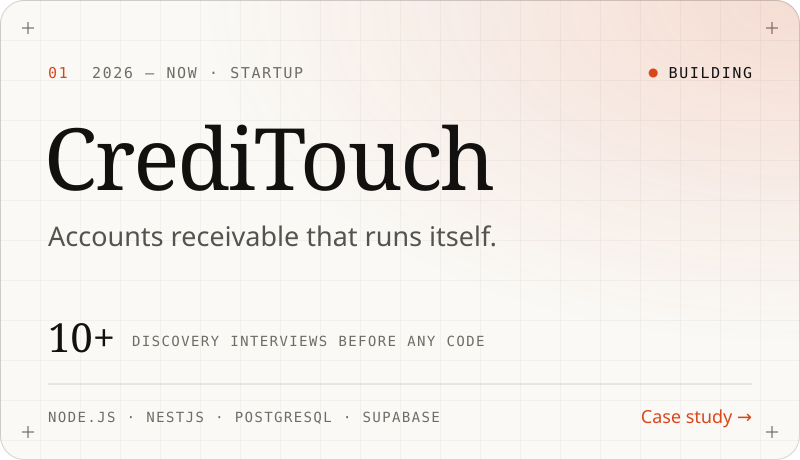
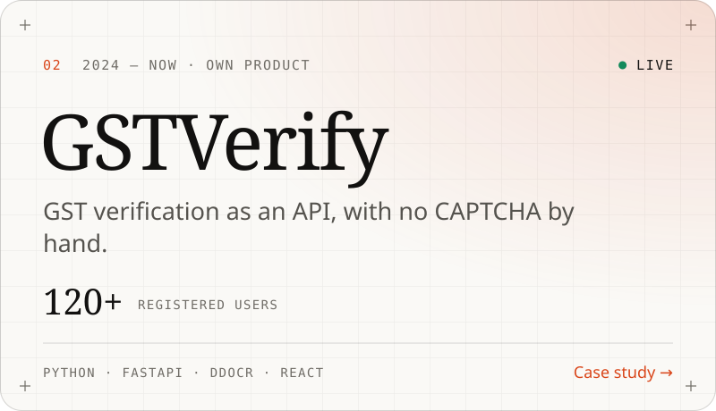
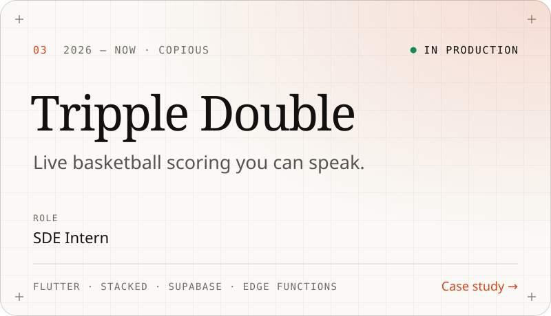
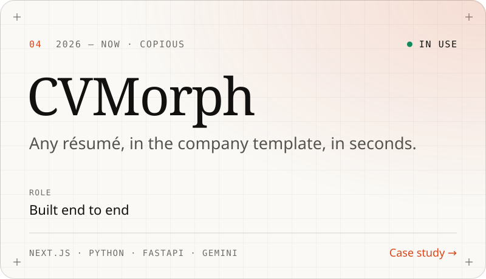
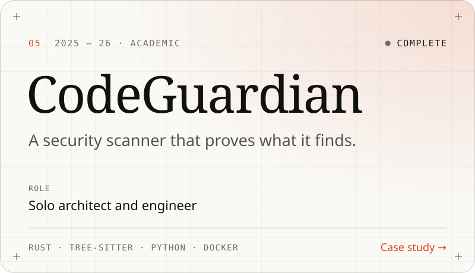
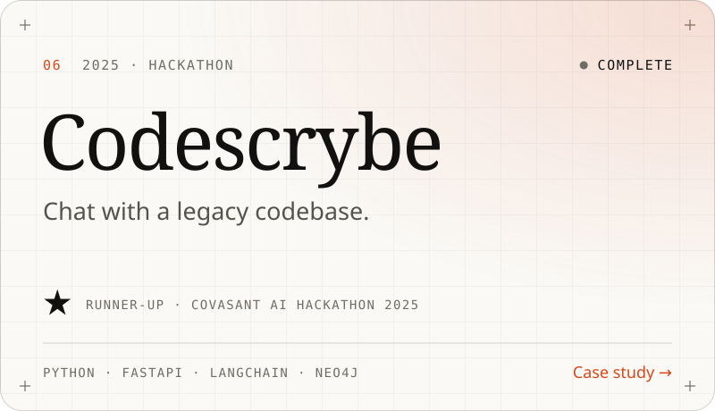

<!-- Generated by `npm run profile` from src/content. Edit the content, not this file. -->

<a href="https://dubey.app"><picture><source media="(prefers-color-scheme: dark)" srcset="./profile/banner-dark.svg"></picture></a>

<a href="https://dubey.app"><b>dubey.app</b></a> &nbsp;·&nbsp; <a href="mailto:shubham@dubey.app">shubham@dubey.app</a> &nbsp;·&nbsp; <a href="https://www.linkedin.com/in/shubhamdubey772/">LinkedIn</a> &nbsp;·&nbsp; <a href="https://x.com/Shubham_dubey4">X</a> &nbsp;·&nbsp; <a href="https://leetcode.com/u/shubham_dube">LeetCode</a>

 

Co-founder and CEO of CrediTouch. SDE Intern at COPIOUS. I have built four apps that are live on the Play Store, I run a paid API product, and I have built voice AI, payroll and security tooling from the first schema to production.

### Now

- **Building [CrediTouch](https://dubey.app/work/creditouch)**: accounts receivable that runs itself. I ran 10+ customer interviews before writing code, then built the whole backend.
- **SDE Intern at COPIOUS**: voice AI live scoring for [Tripple Double](https://dubey.app/work/tripple-double), and [CVMorph](https://dubey.app/work/cvmorph) for the talent team.
- **Open to SDE, backend and AI roles**. Remote first, happy to relocate.

### Selected work

<a href="https://dubey.app/work/creditouch"><picture><source media="(prefers-color-scheme: dark)" srcset="./profile/cards/creditouch-dark.svg"></picture></a>
<a href="https://dubey.app/work/gstverify"><picture><source media="(prefers-color-scheme: dark)" srcset="./profile/cards/gstverify-dark.svg"></picture></a>

<a href="https://dubey.app/work/tripple-double"><picture><source media="(prefers-color-scheme: dark)" srcset="./profile/cards/tripple-double-dark.svg"></picture></a>
<a href="https://dubey.app/work/cvmorph"><picture><source media="(prefers-color-scheme: dark)" srcset="./profile/cards/cvmorph-dark.svg"></picture></a>

<a href="https://dubey.app/work/codeguardian"><picture><source media="(prefers-color-scheme: dark)" srcset="./profile/cards/codeguardian-dark.svg"></picture></a>
<a href="https://dubey.app/work/codescrybe"><picture><source media="(prefers-color-scheme: dark)" srcset="./profile/cards/codescrybe-dark.svg"></picture></a>

<b>More projects</b> · 16 more, from AI agents to a C++ process manager

 

| Project | What it is | Stack |
|---|---|---|
| [**Assetcop**](https://dubey.app/work/assetcop) | Every machine, vehicle and AC, with its whole history. 1 month Idea to Play Store, solo | Flutter · BLoC · Node.js · Express |
| [**Ophiz Payroll**](https://dubey.app/work/ophiz) | Indian payroll for 10,000+ employees. 10,000+ Employees onboarded | Flutter · BLoC · Node.js · MongoDB |
| [**Debtorz**](https://dubey.app/work/debtorz) | A debt tracker with WhatsApp-grade chat. 100+ Flutter widget tests | Flutter · BLoC · Material 3 · Isar |
| [**ContrarianAI**](https://dubey.app/work/contrarian-ai) | The only AI built to disagree with you. | LangChain · FAISS · HuggingFace · Tavily |
| [**Storyframe**](https://dubey.app/work/storyframe) | From a pitch to a cinematic storyboard. | Python · FastAPI · spaCy · scikit-learn |
| [**AnonVision**](https://github.com/shubham-dube/anonvision) | Real-time video anonymisation you can talk to. 28 FPS Face blur on GPU, no frame skip | Python · OpenCV · YOLOv8 · DeepFace |
| [**FleetFlow**](https://github.com/shubham-dube/fleetflow) | Fleet management, built solo for a hackathon. Top 72 of 1,000+ teams · Odoo Hackathon | Next.js · TypeScript · Prisma · PostgreSQL |
| [**GPA Genie**](https://chromewebstore.google.com/detail/jngdobcmcgkecmflglfdbnjnaekmobfn) | The Chrome extension my whole campus uses. Winner · Campus Utility App Challenge | JavaScript · React · Chrome Extension APIs |
| [**Typeform clone**](https://github.com/shubham-dube/Typeform) | A full form builder: build, share, collect. | FastAPI · SQLAlchemy 2 · Pydantic v2 · pytest |
| [**Flow Dash**](https://github.com/shubham-dube/flowdash) | Real-time project and task management. 100+ Users | Next.js · React · MongoDB · Firebase |
| [**Influenza protein classifier**](https://github.com/shubham-dube/influenza-protien-classification) | Classifying virus proteins from 3D structure. | Python · scikit-learn · NumPy · Pandas |
| [**Eduspace**](https://github.com/shubham-dube/eduspace) | A tutoring app for tutors and students. | Flutter · Firebase · Supabase |
| **Dynamic QR attendance** | Attendance codes that expire in seconds. | Flutter · Node.js · MongoDB |
| **IRCTC booking automation** | Tatkal tickets, booked end to end. | Python · Selenium · Tesseract OCR · PyQt |
| [**Car Connect**](https://github.com/shubham-dube/Car_Connect) | Two apps, one marketplace for car parts and services. | Flutter · Provider · Node.js · Express |
| [**Process manager**](https://github.com/shubham-dube/Computer-Processes-Manager-CPP-Program) | A Windows task manager in the terminal. | C++ · Win32 API |

### Experience

**Co-Founder & CEO** · CrediTouch My startup · fintech, B2B SaaS  
JUN 2026 — PRESENT · REMOTE  
Co-founded with Nandini Raj to automate accounts receivable. I ran the customer discovery and designed and built the entire backend. Built here: [CrediTouch](https://dubey.app/work/creditouch).

**SDE Intern** · COPIOUS Johannesburg, South Africa  
JUN 2026 — PRESENT · REMOTE  
Building Tripple Double, a basketball platform for recruitment, competitions, live scoring and fans, and internal AI tools for the staffing team. Built here: [Tripple Double](https://dubey.app/work/tripple-double), [CVMorph](https://dubey.app/work/cvmorph).

**SDE Intern · Flutter** · Kartavya Technology  
JAN 2025 — MAY 2026 · REMOTE  
Shipped three production apps to Google Play, two of them solo, across HR, finance and asset management. Built here: [Ophiz Payroll](https://dubey.app/work/ophiz), [Debtorz](https://dubey.app/work/debtorz), [Assetcop](https://dubey.app/work/assetcop).

**SDE Intern · Flutter & Backend** · Ridobiko Vehicle rentals  
JUL — OCT 2024 · REMOTE  
Built KYC automation that verifies Indian documents against government portals. Built here: [GSTVerify](https://dubey.app/work/gstverify).

ALSO Full Stack Developer, IIIT Raichur (Nov 2024 — Present) · Science & Technology Secretary, IIIT Raichur (Oct 2024 — Oct 2025)

### Stack

<a href="https://dubey.app/#capabilities"><picture><source media="(prefers-color-scheme: dark)" srcset="https://skillicons.dev/icons?i=ts,py,dart,rust,cpp,nodejs,nestjs,fastapi,flutter,nextjs,react,tailwind,postgres,supabase,mongodb,firebase,redis,docker,gcp,aws,linux,git&perline=11&theme=dark"></picture></a>

### Recognition

- **Runner-up**, Covasant AI Hackathon · Codescrybe, with Team Repolens 2025
- **Round 3 shortlist**, Flipkart Grid 2026
- **Top 72 of 1,000+ teams**, Odoo Hackathon virtual round · FleetFlow, solo 2026
- **Winner**, Campus Utility App Challenge · GPA Genie 2024
- **Honourable mention**, Code Cubicle 2.0 Hackathon · team lead 2024
- **Selected delegate**, National Wellbeing Conclave, IIT Hyderabad
- **AIR ~43,000**, JEE Main, among ~11 lakh candidates 2023

 

This README and <a href="https://dubey.app">dubey.app</a> are built from the same typed content, in this repository. How it works: <a href="./docs/DEVELOPMENT.md">docs/DEVELOPMENT.md</a>

